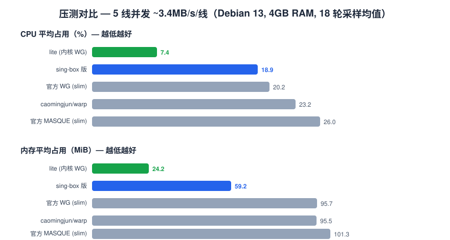
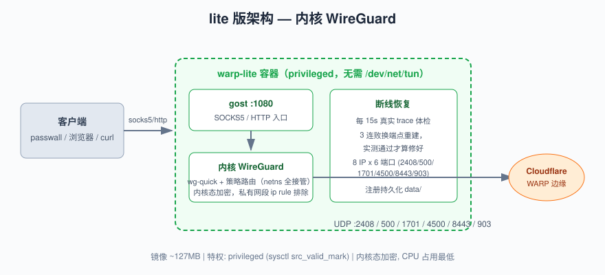
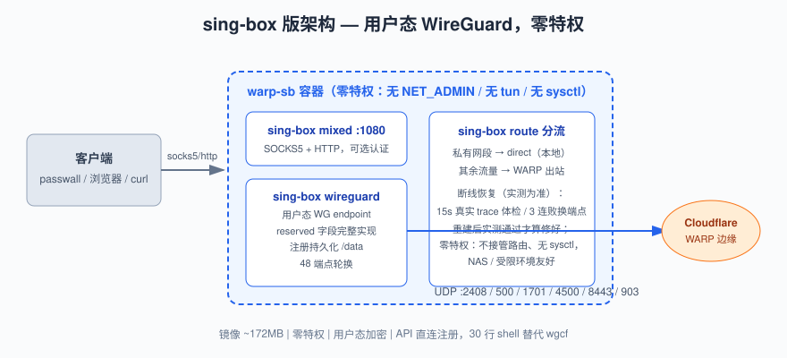

# warp-socks-pool

**pool = 48 端点池**：8 个 Cloudflare WARP 入口 IP × 6 个端口（2408/500/1701/
4500/8443/903）交叉成池，断线换线像换电池一样自然——这也是它在国内网络
能稳定连上的关键。

把 Cloudflare WARP 变成一个 SOCKS5/HTTP 代理容器的两个自研方案（镜像
~127MB 起步）。一条 `docker run` 命令部署到任何有 Docker 的 Linux 主机，
全部经过大陆电信网络实测与 5 线并发压测。

| | [lite/](lite/) | [sing-box/](sing-box/) |
|---|---|---|
| 镜像 | **~127MB** | ~172MB |
| 隧道实现 | 内核 WireGuard（wg-quick） | sing-box 用户态 WireGuard |
| 特权要求 | `privileged: true` | **零特权**（无 NET_ADMIN / tun / sysctl） |
| 协议 | WireGuard | WireGuard（reserved 字段完整实现） |
| 端点轮换 | 48 端点（8 IP × 6 端口） | 48 端点（8 IP × 6 端口） |
| 注册持久化 | ✓ | ✓ |
| 断线恢复 | 每 15s 发一次真实 trace 请求体检（流量真实走隧道），连续 3 次失败才判死 → 换端点重建；重建后继续实测，确认真的通了才算修好 | 同样以实测为准：15s 检查 / 3 连败重建。区别只在重建动作是重启 sing-box 进程（lite 是重建 WG 接口），恢复同样以实测通过为准 |
| 代理认证 | gost 参数（可选） | `SOCK_USER`/`SOCK_PWD` 环境变量 |
| 适用场景 | 低配机器、大流量长跑 | NAS / 受限环境 / 通用部署 |



> 压测环境：Debian 13，Docker 28.5，4GB RAM；5 条线路并发各 ~3.4MB/s，每线
> ~410MB/2min，18 轮采样。基线对照为 [caomingjun/warp](https://github.com/cmj2002/warp-docker)
> 与官方 `warp-svc` 客户端（自构建 slim 版）。

## 两个方案怎么选

一句话：怕麻烦选 sing-box 版，抠资源选 lite 版。

- **默认选 [sing-box 版](sing-box/)**：零特权意味着 NAS、受限容器环境、共享宿主
  都能跑；`reserved` 字段完整实现（内核版发全零，Cloudflare 收紧策略时它更抗风险）。
- **低配机器 / 大流量长跑选 [lite 版](lite/)**：内核态加密，CPU 只有 sing-box 的
  40%、官方客户端的 30%，内存只有 1/3。代价是必须 privileged。

两者共同点：48 端点交叉轮换（8 IP × 6 端口，端口含实测可用的 8443/903）、
注册持久化（重启不换身份）、断线恢复（每 15s 用一次真实 trace 请求体检，
连续 3 次失败才动手重建，修好后要实测通过才算数）、`EXPECT` 出口地区校验。

## 快速开始

```
# 开箱即用方式
1. lite 版
docker run -itd --name warp1082 --privileged --sysctl net.ipv4.conf.all.src_valid_mark=1 -p 1082:1080 -v /tmp/warp-wg-data1082:/etc/wireguard life8688/warp-wg-lite:latest

2. sing-box 版（零特权，推荐）
docker run -itd --name warp-sb1083 -p 1083:1080 -e CHECK_INTERVAL=10 -v /tmp/warp-sb1083:/data   life8688/warp-sb:latest

```

```bash
# sing-box 版（零特权，推荐）
cd sing-box
# --build-arg HTTPS_PROXY 是【可选】的：它只在"构建镜像、从 GitHub 下载
# sing-box 二进制"这一步生效。网络能直连 GitHub 就直接 docker compose build，
# 什么都不用加。它绝不会让容器运行期的流量走这个代理。
docker compose build --build-arg HTTPS_PROXY=socks5h://<你的代理>:<端口>
docker compose up -d
curl --socks5-hostname 127.0.0.1:1085 https://cloudflare.com/cdn-cgi/trace
```

```bash
# lite 版（内核 WG，需 privileged）
cd lite
# 构建代理同样可选：只影响构建期下载 wgcf/gost，与运行期流量无关
docker compose build --build-arg HTTPS_PROXY=socks5h://<你的代理>:<端口>
docker compose up -d
curl --socks5-hostname 127.0.0.1:1082 https://cloudflare.com/cdn-cgi/trace
```

输出含 `warp=on` 即成功（`loc=` 是出口地区，`ip=` 是 WARP 出口 IP）。
第一次跑不通别慌，先翻对应目录 README 的 FAQ——大陆网络上的坑基本都替
你踩过了。详细参数、docker run 示范、运维命令也都在那里。

## 目录结构

```
├── lite/            # 内核 WireGuard 版
│   ├── Dockerfile / entrypoint.sh / healthcheck.sh / docker-compose.yml / README.md
├── sing-box/        # sing-box 用户态 WireGuard 版
│   └── ...
└── docs/images/     # 架构图与压测图
```

## 架构图





## 说明

- 出口地区由主机物理位置决定（WARP 机制，与实现无关）。
- 443 端口是 MASQUE 专用，WireGuard 在该端口无应答（已实测），故不入端点池。
- 本项目与 Cloudflare 无关联；请遵守所在地区法律法规使用。
