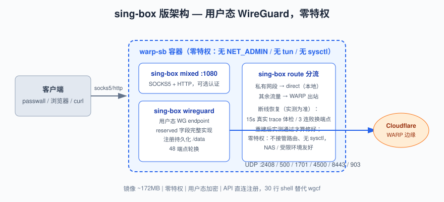

# sing-box — 零特权用户态 WireGuard WARP 代理（~172MB）

用 sing-box 的 `wireguard endpoint`（用户态 WireGuard，`reserved` 字段完整实现）
连接 WARP，`mixed` 入站暴露 SOCKS5/HTTP 代理。**容器不需要任何特权**——
无 NET_ADMIN、无 tun 设备、无 sysctl、不接管路由，NAS 和受限环境可跑。
一句话：协议实现最正、部署门槛最低的一版。



## 特性

- **零特权**：WG 握手在 sing-box 进程内完成，只有进入代理端口的流量才走隧道，
  容器自身网络零改动
- **IPv6 出口**（`EGRESS=v6`，默认）：出网走 WARP 分配给**本机设备**的 /128 IPv6，
  不再和成千上万 WARP 用户挤同一个共享 IPv4 出口 NAT。CT 日志、Google 系接口这类
  按源 IP 计配额的站点，共享 v4 出口基本必 429，v6 出口配额是独立的
- **拿不到 v6 也不会废**：`v6` 是"优先"不是"强制"。先试 `V6_TRIES` 个端点找 v6，
  找不到就自动退回 v4 继续服务（日志一条 WARN），任何环境下容器都能用。
  真要"没 v6 就宁可不可用"，用 `EGRESS=v6only`
- **出口族体检**：每次体检除了 `warp=on`，还解析 trace 里的 `ip=` 看实际出口地址，
  不会出现"warp=on 但其实是 v4"的假健康
- `reserved` 字段完整实现：`client_id` 正确解码为 3 字节注入握手包
  （内核 WireGuard 只能发全零，Cloudflare 收紧策略时本方案更抗风险）
- 30 行 shell 直调 WARP API 注册（openssl 生成 X25519 密钥对），无 wgcf 依赖
- 注册持久化：账号存 `/data/account.json`，重启不换身份
- 48 端点轮换（8 IP × 6 端口）+ 断线恢复：每 15s 通过代理端口发一次真实
  trace 请求体检，连续 3 次失败才判死 → 换端点重启 sing-box；重建后同样
  以实测通过为准，不通就继续轮换，直到真的通了才算修好
- 一个端口同时提供 SOCKS5 + HTTP，`SOCK_USER`/`SOCK_PWD` 可选认证
- 私有网段（10/8、172.16/12、192.168/16 等）在 sing-box route 层直连本地

## 限制

- 仅 WireGuard 协议（不支持 MASQUE）
- 用户态加密：大流量下 CPU 高于内核 WG 版（压测 18.9% vs 7.4%），
  但仍低于官方客户端（20-26%）
- 首次建立时大陆网络可能轮换数个端点（WG 新会话握手随机被丢，属正常现象）

## Step by Step

### 1. 构建镜像

```bash
git clone https://github.com/jamosnet/warp-socks-pool && cd warp-socks-pool/sing-box

# --build-arg HTTPS_PROXY 是【可选】的：仅构建镜像时用来从 GitHub 下载
# sing-box 二进制。能直连 GitHub 就直接 docker compose build，什么都不用加。
# 它只在构建期生效，容器运行期的流量与它毫无关系，不要误会成
# "所有流量都要走代理"。
docker compose build --build-arg HTTPS_PROXY=socks5h://192.168.1.1:10808
```

### 2. 启动

```bash
docker compose up -d
```

compose 默认映射宿主 1085 → 容器 1080，账号持久化在 `./data`。

### 3. 验证

```bash
# 隧道是否通
curl --socks5-hostname 127.0.0.1:1085 https://cloudflare.com/cdn-cgi/trace
# 出口到底是 v4 还是 v6（含 ":" 即 IPv6）
curl --socks5-hostname 127.0.0.1:1085 https://api64.ipify.org; echo
```

第一条输出含 `warp=on`、第二条是一个 IPv6 地址，才算达标。

### 4.（可选）docker run 部署

```bash
# 最简：全默认参数（注意：无任何特权参数，默认 EGRESS=v6）
docker run -d --name warp1085 \
  -p 1085:1080 \
  -v /tmp/warp-sb-data:/data \
  warp-sb:latest

# 显式指定 IPv6 出口 + 认证 + 地区校验
docker run -d --name warp-sb-auth \
  -p 1086:1080 \
  -e EGRESS=v6 \
  -e SOCK_USER=myuser \
  -e SOCK_PWD=mypass \
  -e EXPECT=US \
  -e CHECK_INTERVAL=10 \
  -v /tmp/warp-sb-auth:/data \
  warp-sb:latest
```

> 对比：官方客户端方案需要 `--cap-add=NET_ADMIN --device=/dev/net/tun
> --sysctl ...` 三件套，本版一个特权参数都没有。

### 5. 为什么要 IPv6 出口

WARP 的 IPv4 出口是**共享 NAT 公网地址**，一个地址背后几千个用户。按源 IP 计配额的
服务（Google CT 日志 `ct.googleapis.com`、部分 Google API）会直接把这份共享配额耗光，
表现就是长期 100% `429`，一个成功都没有 —— 这跟并发无关，单发也 429。

WARP 给每个设备分配的 IPv6 是独立的 `/128`，配额独立，所以 `EGRESS=v6` 默认开启。

### 6. 环境拿不到 IPv6 会怎样

`v6` 是"优先"，不是"强制"。启动后先用 `V6_TRIES`（默认 3）个端点去找 IPv6 出口，
约 33 秒内找不到就**自动退回 IPv4 继续服务**，只在日志里留一条 WARN：

```
[entrypoint] 已试 3 个端点仍无 IPv6 出口, 软降级为 IPv4 继续服务(要严格拒绝 v4 请用 EGRESS=v6only)
[entrypoint] 警告: 出口为 IPv4 (104.28.x.x)。容器照常可用, 但配额又回到共享 NAT
```

| 模式 | 拿不到 v6 时 | 适用 |
|---|---|---|
| `EGRESS=v6`（默认） | 退 v4，容器照常可用 | 生产。有 v6 就用 v6，没有也不耽误事 |
| `EGRESS=v6only` | 不降级，一直轮换/重试，端口不可用 | 只在明确要求"必须是 v6 出口"时用 |
| `EGRESS=v4` | 本来就是 v4 | 回到改造前的行为 |

另外两点容易误解：

- **宿主机没有 IPv6 不影响**。WARP 的 v6 是隧道内地址，隧道本身跑在 v4 上，纯 v4 主机
  一样能拿到 v6 出口。真正决定成败的是**目标域名有没有 AAAA 记录**、以及 WARP 有没有
  给这个账号分配 v6。
- **账号没分配 v6** 时，`v6` 模式下直接按 v4 起（日志一条警告），`v6only` 模式下才报错退出。


验证一次就能判死：

```bash
# 单发一条最轻的 CT 请求
curl -s -o /dev/null -w 'v4: %{http_code}\n' --socks5-hostname 127.0.0.1:1085 -4 \
  'https://ct.googleapis.com/logs/us1/argon2026h2/ct/v1/get-sth'
curl -s -o /dev/null -w 'v6: %{http_code}\n' --socks5-hostname 127.0.0.1:1085 -6 \
  'https://ct.googleapis.com/logs/us1/argon2026h2/ct/v1/get-sth'
```

## 参数

### 运行时环境变量

| 变量 | 默认 | 说明 |
|---|---|---|
| `PROXY_PORT` | `1080` | sing-box mixed 入站端口（SOCKS5 + HTTP 同端口） |
| `CHECK_INTERVAL` | `15` | 守护循环检查间隔（秒） |
| `EGRESS` | `v6` | 出口地址族。`v6`=优先 IPv6（拿不到自动退回 v4，服务不中断）；`v6only`=强制 IPv6（拿不到就不可用，绝不走 v4）；`v4`=强制 IPv4 |
| `DNS_MODE` | `local` | 目标域名解析位置。`local`=容器 DNS；`remote`=走 WARP 内 DoH（主机 DNS 不返回 AAAA 时改这个） |
| `V6_TRIES` | `3` | `v6` 模式下先用几个端点去找 IPv6 出口，用完仍没有就软降级 v4（每个端点约 11 秒） |
| `EXPECT` | 空 | 出口地区校验（如 `US`），不符视为故障触发轮换 |
| `SOCK_USER` / `SOCK_PWD` | 空 | 代理认证（两者都设置才启用） |
| `WARP_API` | CF 官方注册 API | 注册接口地址 |
| `WARP_SERVER` / `WARP_PORT` | `engage.cloudflareclient.com` / `2408` | 域名端点回退配置 |

### 构建期 build-arg

| 变量 | 默认 | 说明 |
|---|---|---|
| `SINGBOX_VERSION` | `1.14.2` | sing-box 版本（1.14.x 分支） |
| `HTTPS_PROXY` / `HTTP_PROXY` | 空 | 可选。仅构建镜像时下载 sing-box 用，不填则直连下载；不影响运行期流量 |

### 持久化卷

| 路径 | 内容 |
|---|---|
| `/data/account.json` | WARP 账号（私钥 + 注册响应，删除即重新注册） |
| `/data/cache.db` | sing-box DNS 缓存 |

## 运维

```bash
docker logs -f warp1085 | grep entrypoint            # 建立/轮换过程
docker exec warp1085 tail -20 /var/log/singbox.log   # sing-box 运行日志
docker exec warp1085 sing-box check -c /etc/sing-box/config.json   # 校验配置
docker restart warp1085                              # 手动重建
docker rm -f warp1085 && rm -rf ./data && docker compose up -d   # 重新注册
# 改脚本后必须 rebuild；build 完建议比对容器内 /entrypoint.sh 的 md5
docker compose build && docker compose up -d --force-recreate
```

## 压测数据

见根目录 [benchmark](../README.md#压测对比)：CPU 18.9%、内存 59.2 MiB，
均优于官方客户端方案（20-26% / 95-101 MiB），低于内核 lite 版（7.4% / 24.2）。

## FAQ

- **想要 v6 但日志说"软降级为 IPv4"？** 说明目标域名没解析出 AAAA。先把
  `DNS_MODE` 改成 `remote`（走 WARP 内 DoH 解析）重建；若还是 v4，就是该 WARP 账号
  没分配 IPv6，删掉 `/data/account.json` 重新注册。注意此时容器**照常可用**，只是
  配额回到共享 v4。
- **`429` 和并发有没有关系？** 没有。429 是目标站按源 IP 计配额，单发也会中。共享
  IPv4 出口被打穿是常态，换 IPv6 出口才是根治。
- **断线恢复是"自己给自己看病"吗？** 不是。每次判断都来自通过代理端口的
  真实 trace 请求：实测通了才算恢复，不通就换端点重启 sing-box，直到实测
  通过为止。
- **首次建立一直在轮换？** 正常：WG 新会话握手在部分网络被随机丢弃，
  48 端点池自动寻找可用组合（实测 1-4 轮成功）。
- **为什么镜像比 lite 大？** sing-box 二进制 ~40MB；换来的是零特权与
  正确的协议实现。
- **为什么不用 gost？** sing-box 的 `mixed` 入站原生同时提供 SOCKS5 与 HTTP，
  且认证、UDP 转发一体化。
- **`domain_resolver` 报错？** sing-box 1.14.2 的 peer 结构不支持该字段
  （新版本移到了别处），本仓库配置已适配 1.14.2。
